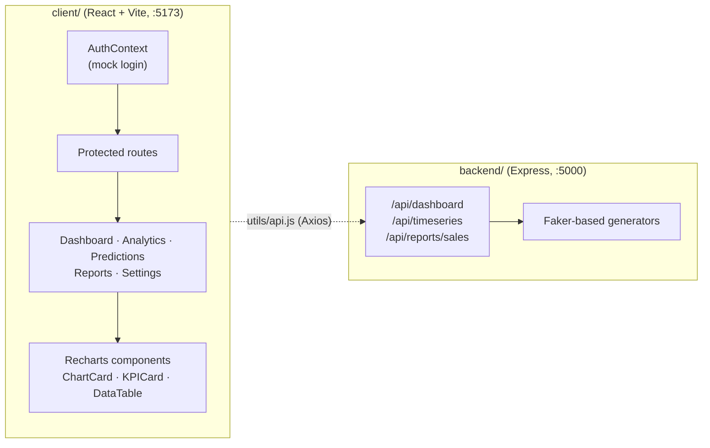

<div align="center">

# Insight Analytics Pro

**A dark-themed business intelligence dashboard for revenue, sales, forecasts and reports, built with React, Vite and Recharts.**

[](https://react.dev)
[](https://vitejs.dev)
[](https://tailwindcss.com)
[](https://recharts.org)
[](https://www.framer.com/motion/)
[](https://reactrouter.com)
[](https://nodejs.org)
[](https://expressjs.com)

</div>

## About

Insight Analytics Pro is a front-end-focused business and finance dashboard that turns sales,
revenue and customer metrics into an executive overview, deeper analytics, forecasts and reports.
It is built as a **React single-page app** with animated page transitions, a collapsible sidebar and a
consistent dark UI, plus a small **Express mock API** that generates realistic sample data. All data
in the project is synthetic; it is a UI and data-visualisation showcase rather than a connected product.

## Features

- **Executive dashboard**: KPI cards for revenue, customers, conversion rate and market share, plus revenue trend, actual-vs-forecast, sales-by-category and customer-acquisition charts.
- **Advanced analytics**: time-series analysis, segment distribution, correlation analysis and a detailed metrics view.
- **Predictive analytics**: 12-month revenue projection with confidence bands, seasonal patterns and forecast scenarios.
- **Business reports**: quarterly performance, sales by region and product, and a top-customers table.
- **Settings**: general preferences and data-source / cache options.
- **Mock authentication**: client-side login with sample roles (Admin, Analyst, Viewer), session kept in `localStorage` and protected routes.
- **Mock data API**: Express endpoints that generate KPIs, regional/product sales, customers and a time series with a trend-plus-seasonality forecast.
- **Work in progress**: an *Insights* engine page and a *Banking* page with a simulated bank / crypto-exchange connection flow exist in `src/pages` but are not yet wired into the router.

## Tech stack

| Area | Choice |
| --- | --- |
| Frontend | React 18, Vite 4, React Router 6 |
| Styling & motion | Tailwind CSS 3, Framer Motion, Headless UI, Heroicons |
| Charts | Recharts |
| HTTP client | Axios |
| Backend (mock) | Node.js, Express, Faker, Moment, CORS |

## How it works



The pages currently render with local sample data; `client/src/utils/api.js` provides an Axios client
for the Express endpoints (including a static fallback) so the views can be switched to the API.

## Getting started

**Prerequisites:** Node.js 18+ and npm.

```bash
# 1. Mock API (http://localhost:5000)
cd backend
npm install
npm run dev        # or: npm start

# 2. Frontend (http://localhost:5173), in a second terminal
cd client
npm install
npm run dev
```

Build the frontend for production with `npm run build` and preview it with `npm run serve`
(both in `client/`). The backend port can be changed with the `PORT` environment variable.

Sign in with one of the sample accounts defined in `client/src/contexts/AuthContext.jsx`
(demo-only, client-side credentials).

### API endpoints

| Method | Endpoint | Returns |
| --- | --- | --- |
| `GET` | `/api/dashboard` | KPIs, sales by region, sales by product |
| `GET` | `/api/timeseries?days=180&forecast=90` | Historical series plus forecast with confidence bounds |
| `GET` | `/api/reports/sales` | Sales by region/product and top customers |

## Project structure

```
backend/
  server.js               Express mock API and data generators
client/
  src/
    App.jsx               layout, routing, protected routes
    contexts/             AuthContext (mock auth)
    pages/                Dashboard, Analytics, Predictions, Reports, Settings, Login (+ Insights, Banking WIP)
    components/           Sidebar, Navbar, KPICard, StatCard, ChartCard, DataTable, InsightEngine, Banking/*
    utils/                api.js, bankingApi.js (Axios clients with fallback data)
  tailwind.config.js
  vite.config.js
```

---

<div align="center">

Built by [Christoph Barton](https://christophbarton.com)

</div>
